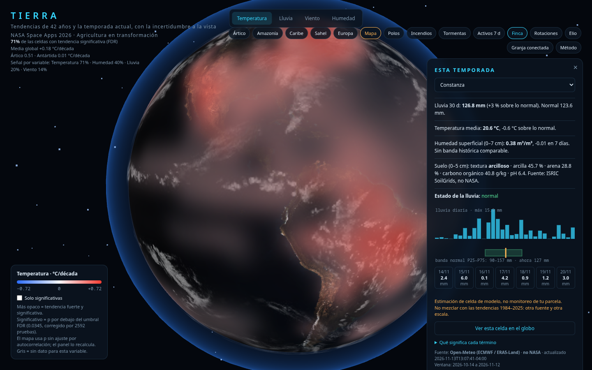
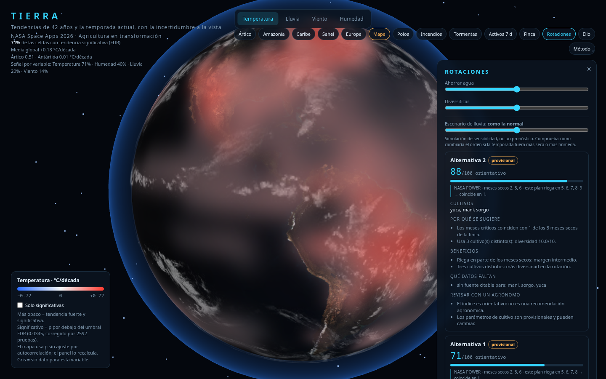
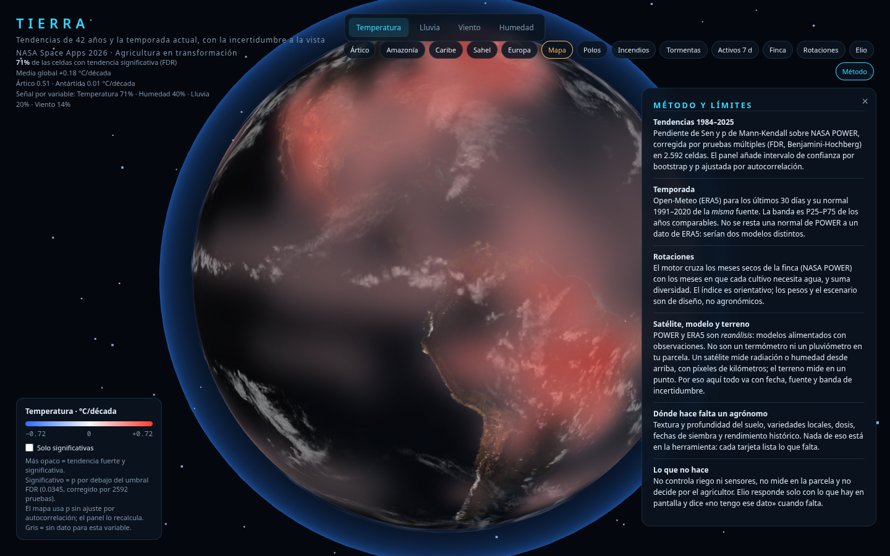

# TIERRA · Detective de Tendencias

Herramienta de apoyo a la decisión para adaptar cultivos con datos de la NASA.
Globo 3D interactivo con tendencias climáticas 1984–2025 y, en desarrollo, una
capa de seguimiento de la temporada actual. Proyecto para **NASA Space Apps
Challenge 2026**.

> Es una herramienta de apoyo: no reemplaza el juicio del agricultor ni de un
> agrónomo local.


## Qué hace

- Globo 3D con una malla de 2.592 celdas de 5° y la tendencia (Sen) de
  temperatura, lluvia, viento y humedad relativa, con p-valor de Mann-Kendall
  **corregido por FDR** (Benjamini-Hochberg sobre las 2.592 pruebas de cada
  variable).
- Panel por celda: pendiente por década, intervalo de confianza por bootstrap,
  p ajustada por autocorrelación y serie 1984–2025 (en vivo desde NASA POWER
  cuando hay red).
- Contraste de lluvia con Open-Meteo (ERA5) para detectar discrepancias de
  reanálisis, etiquetado como **no NASA**.
- Capas de incendios y tormentas activas (EONET) y comparación satelital (GIBS).
- Pestaña **Finca** · "Esta temporada": últimos 30 días de lluvia, temperatura y
  humedad superficial (0–7 cm) contra la banda normal P25–P75, más pronóstico de
  7 días. Fuente **Open-Meteo (no NASA)**, con fecha visible.
- Pestaña **Rotaciones**: 3 estrategias (incluida la actual) con índice
  orientativo, **evidencia NASA** (meses secos de la finca), motivos, beneficios,
  datos faltantes y riesgos. Deslizadores de prioridades (agua/diversidad) y un
  **escenario de sequía** que muestra cuánto aguanta cada plan.
- Panel **Método y límites**: qué es reanálisis, diferencia entre satélite, modelo
  y medición en terreno, y dónde hace falta un agrónomo.
- **Glosario** de términos (anomalía, banda P25–P75, FDR, humedad superficial, ET₀, NDVI).
- **Elio**: asistente que responde solo con los datos de la app, cita la fuente y
  dice "no tengo ese dato" cuando falta. No controla dispositivos.

Los datos de las pestañas nuevas están precalculados en `datos/` y se regeneran
con:

```bash
python3 generar_fincas.py        # climatología POWER 1991-2020
python3 actualizar_reciente.py   # últimos 30 días (Open-Meteo)
python3 generar_rotaciones.py    # motor de rotaciones
python3 generar_suelo.py         # suelo (ISRIC SoilGrids)
```

El globo **no depende de ningún CDN**: `web/vendor/` trae three.js y las texturas
son locales. La app no carga ninguna librería de terceros: las únicas llamadas
externas son las APIs de datos (NASA POWER, GIBS, EONET, Open-Meteo).

### Pestañas

| Finca · esta temporada | Rotaciones | Método y límites |
|---|---|---|
|  |  |  |

## Para el jurado

Resumen de una página: [`docs/para-el-jurado.md`](docs/para-el-jurado.md).

## Cómo abrirlo

Sin instalar nada. Dos formas:

```bash
# opción 1: servidor local (recomendado)
python3 -m http.server 8000
# abrir http://localhost:8000/web/

# opción 2: abrir web/index.html directamente en el navegador
```

Necesita un navegador con WebGL 2 (Chrome, Edge o Firefox recientes).
Necesita internet: three.js, las texturas y las capas en vivo (POWER, GIBS,
EONET) se descargan al abrir. Los datos de tendencia van incrustados en el HTML.

## Datos y fuentes

| Dato | Fuente | Tipo |
|---|---|---|
| Temperatura, lluvia, viento, humedad 1984–2025 | [NASA POWER](https://power.larc.nasa.gov/) (MERRA-2) | **reanálisis** |
| Imágenes satelitales | NASA GIBS (MODIS Terra) | observación |
| Incendios y tormentas | NASA EONET | eventos |
| Contraste de lluvia | Open-Meteo (ERA5) | **no NASA** |

POWER es reanálisis: no es una medición en tu parcela. La lluvia y el viento de
reanálisis son poco fiables; la app los marca con aviso de confianza baja.
Open-Meteo se acredita en `NOTICE` (CC BY 4.0).

## Estructura

```
web/            app de un solo archivo (index.html) + vendor/ (three.js local)
tools/          malla global, tendencia, cliente de POWER, eventos
tests/          pruebas de la lógica y del demo
textures/       texturas del globo
tierra.py       app de escritorio (pygame) — histórico, no es la demo web
```

## Pruebas

```bash
python3 -m unittest discover -s tests -v
```

82 pruebas de Python y 6 de navegador. Las de navegador necesitan
`playwright` y su Chromium (`python3 -m playwright install chromium`); si no están,
se saltan solas. Ninguna prueba necesita internet.

```bash
node tests/elio.mjs    # Elio y los textos de la capa agrícola
```

## Equipo

Reparto de tareas y contratos de datos en [`docs/tareas.md`](docs/tareas.md).

## Límites conocidos

- Abrir el HTML con doble clic (`file://`) no funciona: el navegador bloquea los
  módulos. Hay que servirlo con `python3 -m http.server` (la app lo avisa).
- La capa agrícola y el asistente Elio están en diseño.
- Los puntajes de rotación serán orientativos y se marcarán como provisionales
  cuando falte una fuente citable.

## Licencia

Código bajo MIT (ver `LICENSE`). Datos y librerías de terceros, ver `NOTICE`.
