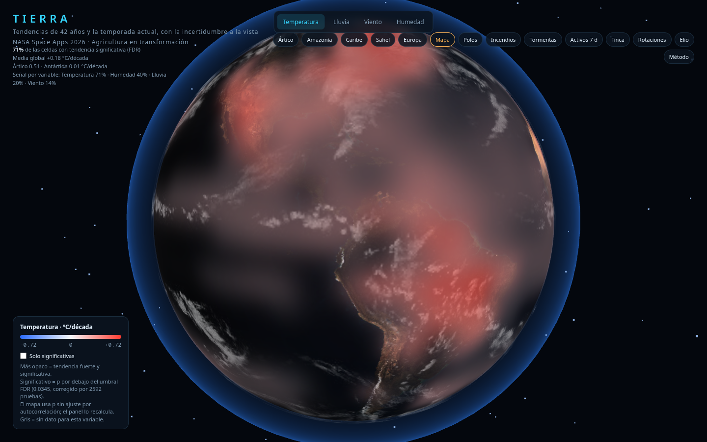
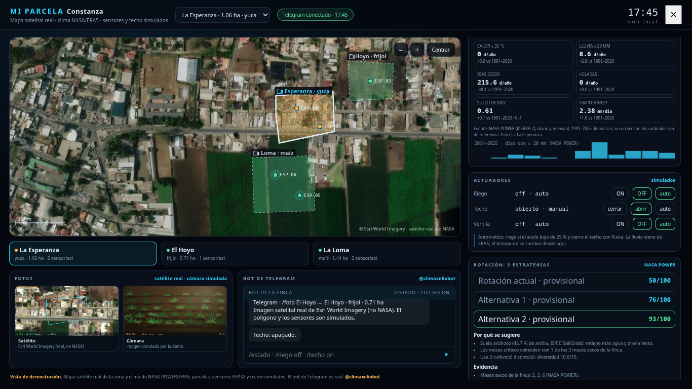
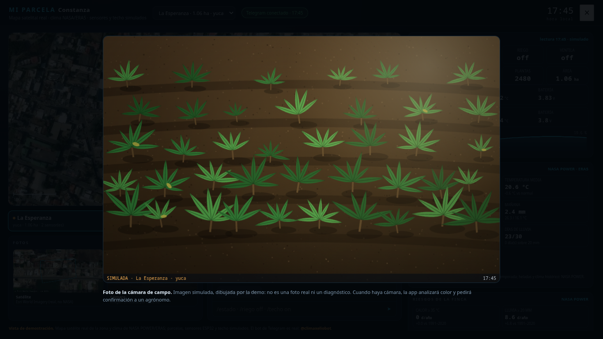
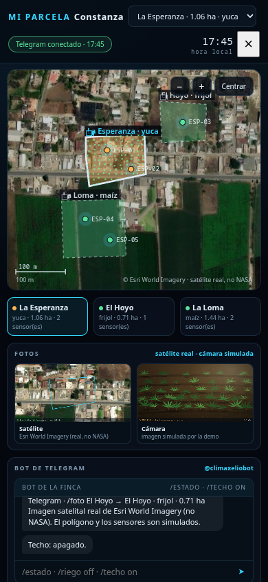
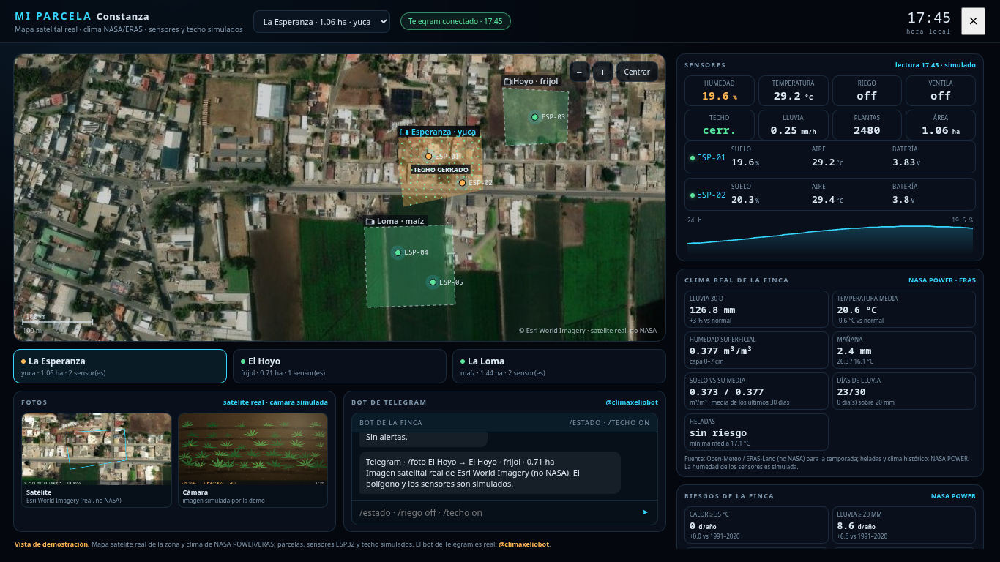
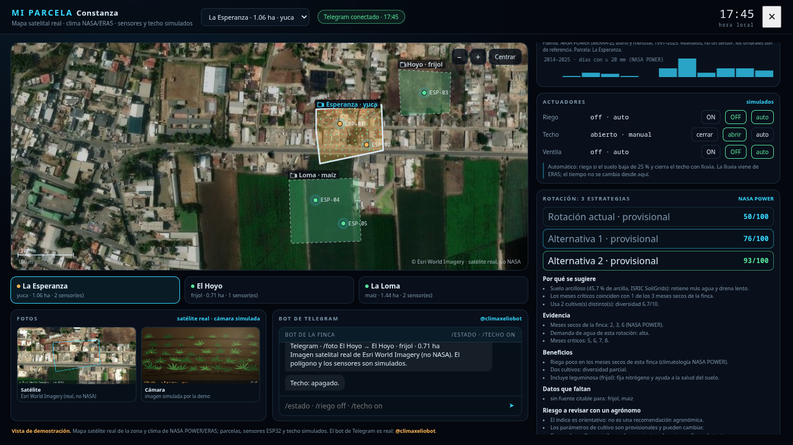
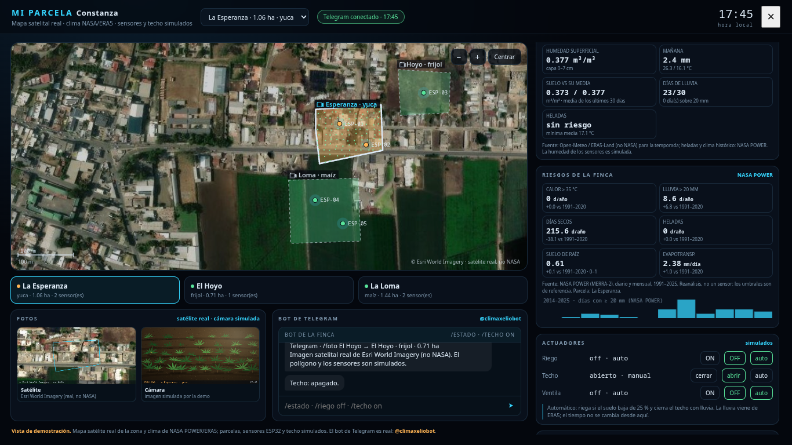

# TIERRA · Detective de Tendencias

Herramienta de apoyo a la decisión para adaptar cultivos con datos de la NASA.
Abre en el **panel de monitoreo de la finca** (parcelas sobre mapa satelital,
sensores, clima real y control por Telegram) y deja el **globo 3D** con 42 años
de tendencia como mapa global. Proyecto para **NASA Space Apps Challenge 2026**.

> Es una herramienta de apoyo: no reemplaza el juicio del agricultor ni de un
> agrónomo local.



## Qué hace

- Globo 3D con una malla de 2.592 celdas de 5° y la tendencia (Sen) de
  temperatura, lluvia, viento y humedad relativa, con p-valor de Mann-Kendall
  **corregido por FDR** (Benjamini-Hochberg sobre las 2.592 pruebas de cada
  variable).
- Panel por celda: pendiente por década, intervalo de confianza por bootstrap,
  p ajustada por autocorrelación y serie 1984–2025 (en vivo desde NASA POWER
  cuando hay red).
- Contraste de lluvia con Open-Meteo (ERA5) para detectar discrepancias de
  reanálisis, etiquetado como **no NASA**.
- Capas de incendios y tormentas activas (EONET) y comparación satelital (GIBS).
- **Mi parcela** (la vista principal, a pantalla completa): mapa satelital real
  con las tres parcelas encima, sus sensores ESP32, la cámara y el techo. Al lado,
  **lecturas de sensores** (humedad de suelo, temperatura, batería), **clima real**
  de la finca (NASA POWER/ERA5), **fotos** (satélite real recortado + foto de
  cultivo simulada dibujada en el navegador), **control de actuadores** (riego,
  techo y ventilación) y la **comparación de las tres rotaciones**. Incluye
  **registro de una parcela nueva dibujándola** sobre el mapa (calcula el área y
  queda donde la dibujaste) y **análisis de una foto** del cultivo (mide color:
  verde, amarillo, marrón). Todo simulado salvo el mapa, el clima y el bot: no hay
  hardware instalado y la app lo dice en pantalla.
- **Riesgos de la finca** (NASA POWER): días ≥ 35 °C, lluvia ≥ 20 mm, días
  secos, heladas, humedad de raíz y evapotranspiración, comparando 1991–2020 con
  2021–2025 y con un gráfico de los últimos 12 años.
- **Cómo se comporta solo**: el riego se dispara con la humedad simulada bajo el
  25 %, y el techo se cierra y el riego se suspende con la **lluvia real de ERA5**
  (no hay un control para "hacer llover").
- **Bot de Telegram real** ([@climaxeliobot](https://t.me/climaxeliobot)) con dos
  modos: **comandos** (`/estado`, `/clima`, `/riego off`, `/techo on`, `/foto`) y
  **API**, donde Elio responde en lenguaje natural con el contexto de los datos.
  El bot escribe el estado en `datos/estado_finca.json` y el panel lo refleja en
  segundos. Ver [`docs/bot-telegram.md`](docs/bot-telegram.md).
- **Globo 3D** (mapa global): la cara NASA de la herramienta. Al abrir una celda
  se ve la pendiente por década, el p-valor con corrección FDR y la serie
  1984–2025; desde ahí se vuelve al monitoreo de la finca en un clic.
- **Rotación: 3 estrategias** (actual y dos alternativas) dentro del monitor, con
  el porqué de cada una, su evidencia NASA (meses secos), beneficios, datos que
  faltan y riesgo a revisar con un agrónomo. Deslizadores de prioridad
  (agua/diversidad) y un escenario de lluvia de sensibilidad, no un pronóstico.
- **Método y límites**: plegado dentro del monitor; explica qué es reanálisis,
  qué es simulado y qué falta validar con un agrónomo.
- **Elio** es el bot de Telegram: responde solo con los datos y sus fuentes, y
  dice "no tengo ese dato" cuando falta.

Los datos de la capa agrícola están precalculados en `datos/` y se regeneran con:

```bash
python3 generar_fincas.py        # climatología POWER 1991-2020
python3 actualizar_reciente.py   # últimos 30 días (Open-Meteo)
python3 generar_rotaciones.py    # motor de rotaciones
python3 generar_suelo.py         # suelo (ISRIC SoilGrids)
python3 generar_riesgos.py      # riesgos: calor, lluvia intensa, secos, heladas, suelo y ET (POWER)
```

El globo **no depende de ningún CDN**: `web/vendor/` trae three.js y las texturas
son locales. La app no carga ninguna librería de terceros: las únicas llamadas
externas son las APIs de datos (NASA POWER, GIBS, EONET, Open-Meteo).

### Capturas

| Mi parcela · monitor | Fotos de la parcela | En el móvil |
|---|---|---|
|  |  |  |

| El globo · mapa global | Techo cerrado | Rotaciones |
|---|---|---|
|  |  |  |

| Riesgos NASA POWER |
|---|
|  |

## Presentaciones

- **Para el jurado / técnico**, una página: [`docs/para-el-jurado.md`](docs/para-el-jurado.md).
- **Para inversores**, guion de 5 minutos y preguntas difíciles:
  [`docs/pitch-inversores.md`](docs/pitch-inversores.md).
- **Diapositivas** (11, sin dependencias, teclas ← →):
  [`docs/deck/index.html`](docs/deck/index.html).
- **Video de respaldo** de 52 s (versión anterior de la vista):
  [`docs/demo.mp4`](docs/demo.mp4). Actualízalo con `tools/grabar_demo.py` si
  cambias la app.

```bash
python3 -m http.server 8000   # y abrir http://localhost:8000/docs/deck/
```

## Cómo abrirlo

Sin instalar nada. Dos formas:

```bash
# opción 1: servidor local (recomendado)
python3 -m http.server 8000
# abrir http://localhost:8000/web/

# opción 2: abrir web/index.html directamente en el navegador
```

Necesita un navegador con WebGL 2 (Chrome, Edge o Firefox recientes).
Necesita internet: three.js, las texturas y las capas en vivo (POWER, GIBS,
EONET) se descargan al abrir. Los datos de tendencia van incrustados en el HTML.

## Reto oficial

Este proyecto responde al reto **«Field Shift: Adapting Farms with NASA Data»**
de NASA Space Apps 2026. Los requisitos (3 rotaciones con evidencia, huecos y
riesgos; incertidumbre; satélite frente a suelo) y la lista de recursos oficiales
están mapeados en [`docs/recursos-nasa.md`](docs/recursos-nasa.md).

## Datos y fuentes

| Dato | Fuente | Tipo |
|---|---|---|
| Temperatura, lluvia, viento, humedad 1984–2025 | [NASA POWER](https://power.larc.nasa.gov/) (MERRA-2) | **reanálisis** |
| Climatología de la finca, heladas, temporada | NASA POWER | **reanálisis** |
| Calor extremo, lluvia intensa, días secos, suelo de raíz y ET | NASA POWER | **reanálisis** |
| Últimos 30 días y humedad superficial 0–7 cm | Open-Meteo (ERA5) | **no NASA** |
| Imágenes satelitales de la finca | Esri World Imagery | **no NASA** |
| Textura, carbono y pH del suelo | ISRIC SoilGrids 2.0 | **no NASA** |
| Imágenes satelitales globales | NASA GIBS (MODIS Terra) | observación |
| Incendios y tormentas | NASA EONET | eventos |

POWER es reanálisis: no es una medición en tu parcela. La lluvia y el viento de
reanálisis son poco fiables; la app los marca con aviso de confianza baja.
Open-Meteo se acredita en `NOTICE` (CC BY 4.0).

## Estructura

```
web/            app de un solo archivo (index.html) + vendor/ (three.js local)
tools/          malla global, tendencia, cliente de POWER, eventos
tests/          pruebas de la lógica y del demo
textures/       texturas del globo
tierra.py       app de escritorio (pygame) — histórico, no es la demo web
```

## Pruebas

```bash
python3 -m unittest discover -s tests -v
```

Las pruebas de Python incluyen el bot (37, sin red) y la lógica del monitoreo;
las de navegador necesitan `playwright` y su Chromium
(`python3 -m playwright install chromium`); si no están, se saltan solas.
Ninguna prueba necesita internet.

```bash
node tests/elio.mjs     # Elio y los textos de la capa agrícola
node tests/vision.mjs   # riego, techo y foto de la granja simulada
node tests/monitor.mjs  # sensores simulados y estado del bot
```

## Equipo

Reparto de tareas y contratos de datos en [`docs/tareas.md`](docs/tareas.md).

## Límites conocidos

- Abrir el HTML con doble clic (`file://`) no funciona: el navegador bloquea los
  módulos. Hay que servirlo con `python3 -m http.server` (la app lo avisa).
- Los sensores, el techo y la cámara son simulados: no hay hardware instalado.
- Los índices de rotación son orientativos y sus parámetros de cultivo están
  marcados como provisionales hasta validarlos con un agrónomo.
- SMAP, GPM/IMERG, Landsat/MODIS, ECOSTRESS, SRTM y GEDI no están integrados
  todavía; el listado oficial y la hoja de ruta están en
  [`docs/recursos-nasa.md`](docs/recursos-nasa.md).

## Licencia

Código bajo MIT (ver `LICENSE`). Datos y librerías de terceros, ver `NOTICE`.
